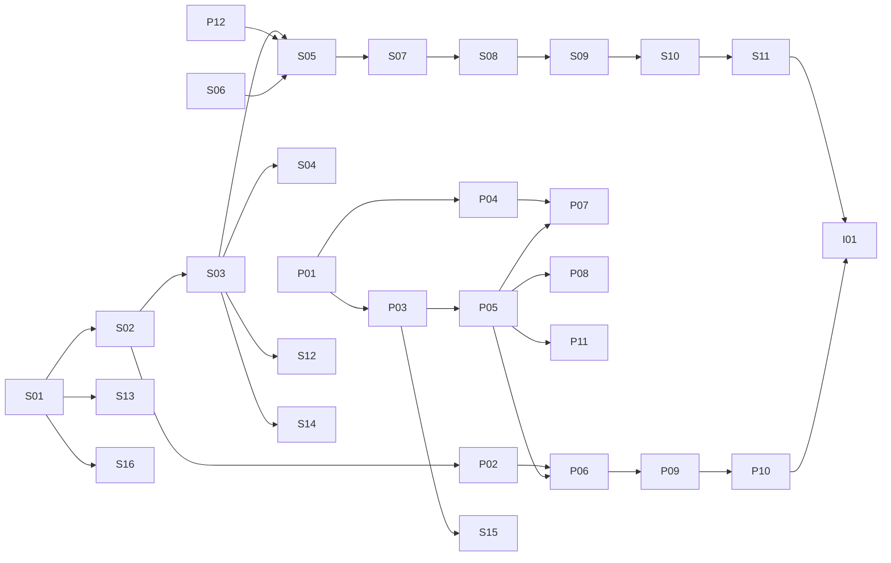

# Etappe 0 – Vorbereitung, Spikes und Zerlegung von Etappe 1

> **Status:** Entwurf zur Freigabe durch den CEO. Grundlage ist [`plan.md`](plan.md) Version 1.4.
> **Konvention:** Wie in `plan.md`. Aussagen mit Quelle sind verifiziert (Abfrage am 25.10.2026).
> Aussagen mit **[Annahme]** sind nicht verifiziert.
> **Inhalt:** (1) Checkliste für den CEO, (2) Entwurf der Anfrage an Anthropic (S4), (3) Plan für die
> Spikes S1–S3, (4) Zerlegung von Etappe 1, (5) vorgeschlagene Änderungen an `plan.md`.

---

## 1. Checkliste für den CEO

Reihenfolge so gewählt, dass nichts auf etwas Späteres wartet. Punkte mit ⚠ wirken nach außen oder
kosten Geld.

### 1.1 VPS mit Backup-Option auswählen ⚠

**Anforderung aus dem Plan:** Ubuntu LTS, 4 vCPU, 8–16 GB RAM, ≥ 80 GB SSD (Kap. 3.4, endgültig nach
S3), Backup-Angebot des Anbieters (E21), Standort in der EU.

**Vergleich (Preise vom 25.10.2026, aus den Produktseiten der Anbieter):**

| Anbieter / Tarif | vCPU | RAM | SSD | Preis/Monat | Backup | Quelle |
|---|---|---|---|---|---|---|
| **Hetzner Cloud CX43** (Cost-Optimized, Intel/AMD, shared) | 8 | 16 GB | 160 GB NVMe | 16,49 € netto | automatisch täglich, 7 Slots; Preis „related to instance“, ab 1,198 € netto | [hetzner.com/cloud/cost-optimized](https://www.hetzner.com/cloud/cost-optimized), [Backup-Doku](https://docs.hetzner.com/cloud/servers/backups-snapshots/overview/) |
| Hetzner Cloud CX33 | 4 | 8 GB | 80 GB NVMe | 8,99 € netto | wie oben | wie oben |
| Hetzner Cloud CPX32 (Regular Performance) | 4 | 8 GB | 160 GB NVMe | 35,99 € netto | wie oben | [hetzner.com/cloud/regular-performance](https://www.hetzner.com/cloud/regular-performance) |
| IONOS VPS L+ | 4 | 8 GB | 240 GB NVMe | 22 € brutto (erste 3 Monate 7 €), 10 € Einrichtung | optional „ab 6 Cent pro GB/Monat“ | [ionos.de/server/vps](https://www.ionos.de/server/vps) |
| IONOS VPS XL+ | 8 | 16 GB | 480 GB NVMe | 41 € brutto (erste 3 Monate 12 €), 10 € Einrichtung | wie oben | wie oben |
| netcup VPS 1000 G12.5 | 4 | 8 GB | 128 GB | 16,68 € brutto bei 12 Monaten Laufzeit | nur „Snapshots“ genannt, kein automatisches Backup-Angebot gefunden | [netcup.com/de/server/vps](https://www.netcup.com/de/server/vps) |

**Wichtige Befunde:**
- **Hetzner zeigt derzeit bei allen Cloud-Tarifen** „This product is currently unavailable“. Die
  Statusseite führt seit 26.06.2026 06:00 UTC den Hinweis „Limited availability of cloud instances“
  ([status.hetzner.com](https://status.hetzner.com/)). Nach Berichten Dritter schränkt Hetzner die
  Neuanlage für neue und zufällig ausgewählte Bestandskunden ein; das habe ich in keiner
  Primärquelle von Hetzner im Wortlaut gefunden **[Annahme]**. Ob Sie bestellen können, zeigt nur
  die Hetzner Console.
- **Backup-Preis bei Hetzner:** Die Seite nennt nur „ab 1,198 €“. Das sind genau 20 % von 5,99 €
  (CX23). Daraus leite ich ab, dass das Backup 20 % des Serverpreises kostet. Für den CX43 wären das
  3,30 € netto **[Annahme, abgeleitet]**.
- **IONOS:** Mindestvertragslaufzeit, Inhalt und Aufbewahrung des Backups stehen nicht auf der
  Produktseite. Vor einer Bestellung im Konfigurator prüfen.
- **netcup** erfüllt E21 nach den gefundenen Angaben nicht (kein automatisches Backup-Angebot).
- **Contabo** konnte ich nicht prüfen (die Seite verweigert den Abruf mit HTTP 403).

**Empfehlung: Hetzner Cloud CX43 im Standort Nürnberg (NBG1), mit Backups.**
Kosten: 16,49 € + ca. 3,30 € = ca. 19,79 € netto, ca. 23,55 € brutto pro Monat **[Backup-Anteil
abgeleitet]**.
Begründung:
- 16 GB RAM und 160 GB Platte liegen am oberen Rand der Anforderung. Speicher ist ein
  Admission-Kriterium (Kap. 5.7). Docker-Images, Registry-Cache und Arbeitsbereiche mit 5 GB je Lauf
  würden 80 GB schnell füllen.
- Automatisches tägliches Backup mit 7 Slots ist im Produkt enthalten (E21).
- Abrechnung pro Stunde mit monatlicher Obergrenze, also keine Vertragsbindung. Ein Wechsel nach S3
  kostet nichts außer Aufwand.
- Standort Deutschland.

Nachteil: „shared vCPU“, Builds können durch Nachbarn langsamer werden. Für das MVP ist das
vertretbar; S3 misst es.

**Rückfallebene, falls Hetzner nicht bestellbar ist:** IONOS VPS L+ (Anforderung erfüllt, 22 €
brutto plus Backup) oder XL+, wenn S3 mehr verlangt. Vorher Laufzeit und Backup-Bedingungen im
Konfigurator prüfen und mir nennen.

**Schritte (Hetzner):**
1. Konto anlegen bzw. anmelden, Projekt „ai-office“ anlegen.
2. SSH-Schlüssel hinterlegen (Ed25519, auf Ihrem Rechner: `ssh-keygen -t ed25519`). **Kein**
   Passwort-Login.
3. Server: Standort NBG1, Image Ubuntu 24.04 LTS (oder die neueste LTS, die angeboten wird), Typ
   CX43, IPv4 + IPv6, **Backups aktivieren**.
4. Hetzner-Firewall anlegen: eingehend nur UDP 51820 (WireGuard) und vorübergehend TCP 22 von Ihrer
   aktuellen IP. Nach Einrichtung des VPN wird TCP 22 auf das VPN beschränkt (siehe 1.2).
5. Mir mitteilen: Anbieter, Tarif, Standort, IP-Adresse. Keine Zugangsdaten schicken.

### 1.2 Grundeinrichtung des Servers und VPN

**Empfehlung VPN: WireGuard, selbst betrieben.**
Begründung: Der kostenlose Tailscale-Tarif „Personal“ ist laut Anbieter „only suitable for
non-commercial use“ ([tailscale.com/pricing](https://tailscale.com/pricing)). Das AI-Office arbeitet
für Ihre Firma; ich halte das nicht für sicher nicht-kommerziell. WireGuard ist im Linux-Kernel
enthalten, kostet nichts und hat keinen Dritten im Kontrollpfad.

**Schritte:**
1. Per SSH als root anmelden, Updates einspielen: `apt update && apt full-upgrade`, danach Neustart.
2. Persönlichen Admin-Nutzer anlegen (mit `sudo`), Root-Login und Passwort-Login für SSH abschalten
   (`PermitRootLogin no`, `PasswordAuthentication no`).
3. `unattended-upgrades` aktivieren (Kap. 5.10).
4. WireGuard: `apt install wireguard`, Server-Schlüssel erzeugen, Schnittstelle `wg0` mit einem
   privaten Netz (Vorschlag `10.77.0.0/24`), je ein Peer für Ihre Geräte (Laptop, Smartphone). Die
   genaue Konfiguration liefere ich als Skript per PR, wenn Sie wollen.
5. SSH nur noch über das VPN erlauben, TCP 22 aus der Hetzner-Firewall entfernen.
6. **Erst prüfen, dann sperren:** Vor Schritt 5 aus einer zweiten Sitzung testen, dass SSH über
   das VPN funktioniert. Die Hetzner-Konsole im Browser bleibt als Notzugang.

**Interne Namen und TLS (neu, im Plan bisher nicht ausgeführt):**
- Die Cookies mit Präfix `__Host-` (Kap. 4.7) verlangen `Secure`, also HTTPS auch im VPN.
- Der Plan nennt `.aio.intern` als Beispiel. `.intern` ist **nicht** reserviert. Reserviert für
  private Nutzung ist `.internal` (ICANN-Beschluss vom 29.07.2024, zitiert in
  [draft-davies-internal-tld-06](https://www.ietf.org/archive/id/draft-davies-internal-tld-06.html)).
  Vorschlag: `office.aio.internal` und `konsole.aio-sup.internal` (verschiedene Domains, wie in Kap.
  5.11 empfohlen).
- Für HTTPS braucht es eine eigene kleine Zertifizierungsstelle. Ihr Stammzertifikat installieren
  Sie einmalig auf Ihren Geräten. Ich liefere das Skript; Sie müssen nur das Zertifikat auf Ihren
  Geräten als vertrauenswürdig eintragen.

### 1.3 GitHub App ⚠

Rechte nach Kap. 5.9. **Der private Schlüssel kommt nie in ein Repo, eine Nachricht oder diesen
Chat.**

1. Profilbild → **Your organizations** → bei `Steuten-IT-Solutions` **Settings** →
   **Developer settings** → **GitHub Apps** → **New GitHub App**
   ([GitHub-Doku](https://docs.github.com/en/apps/creating-github-apps/registering-a-github-app/registering-a-github-app)).
2. **GitHub App name:** z. B. `aio-supervisor` (höchstens 34 Zeichen, weltweit eindeutig).
3. **Homepage URL:** URL des Repos `AI-Office`.
4. **Webhook → Active:** abwählen (Plan: Polling, Kap. 5.9).
5. **Repository permissions:**
   - Contents: Read & write
   - Pull requests: Read & write
   - Issues: Read & write
   - Checks: Read-only
   - Metadata: Read-only (Pflicht)
   - **Workflows: No access** (E30)
   - alles andere: No access
6. **Where can this GitHub App be installed?** „Only on this account“.
7. **Create GitHub App**, dann auf der App-Seite einen privaten Schlüssel erzeugen. Die Datei bleibt
   bis zur Einrichtung des Supervisors offline bei Ihnen.
8. **Installieren** nur auf `AI-Office` („Only select repositories“), **nicht** auf
   `ai-office-supervisor` (E35). Für Spike S1 zusätzlich vorübergehend auf ein Test-Repo (siehe 3.1).

### 1.4 Repo `ai-office-supervisor` ⚠

Anlegen in der Organisation, nur Sie haben Schreibrechte, App nicht installiert (E35).
Sichtbarkeit: siehe Rückfrage 3.

### 1.5 Repo-Einstellungen `AI-Office` ⚠

Nach Kap. 5.9. Pfad: Repo → **Settings**.

1. **Actions → General:** „Workflow permissions“ auf nur Lesen. „Fork pull request workflows from outside collaborators“ auf **Require approval
   for all external contributors**.
2. **Branches → Add classic branch protection rule** für `main`
   ([GitHub-Doku](https://docs.github.com/en/repositories/configuring-branches-and-merges-in-your-repository/managing-protected-branches/managing-a-branch-protection-rule)):
   - Require a pull request before merging
   - Require approvals: 1
   - Dismiss stale pull request approvals when new commits are pushed
   - Require review from Code Owners
   - Require approval of the most recent reviewable push
   - Require status checks to pass before merging (die Checks gibt es erst nach Paket P01)
   - Require branches to be up to date before merging
   - Do not allow bypassing the above settings
   - Allow force pushes: **aus**; Allow deletions: **aus**
   - „Restrict who can push to matching branches“: nur die App. **[Annahme: Ob die App dafür in
     dieser Liste stehen muss, damit ihr Merge per API gelingt, prüft S1.]**
3. `CODEOWNERS` kommt per PR (Paket P01).
4. Die Schritte 2 und 3 erst nach dem Merge von P01 aktivieren. Sonst kann P01 selbst nicht
   gemergt werden. Bis dahin merged nur der CEO.

### 1.6 Claude: `setup-token` und voller Login ⚠

Nach E27 gibt es zwei Zugänge. Beide stellen Sie selbst her, beide auf dem VPS als Nutzer `aio-sup`
(der Nutzer entsteht mit dem Provisionierungsskript aus Paket S16; für die Spikes reicht vorerst ein
eigenes Spike-Verzeichnis).

1. **`setup-token`** (für die Lauf-Container): `claude setup-token` öffnet die
   Browser-Anmeldung. Das Token erscheint im Terminal und wird **nirgends gespeichert**. Es läuft ein
   Jahr und „can only make model requests“
   ([Doku](https://code.claude.com/docs/en/authentication#generate-a-long-lived-token)).
   Ablage: Datei `/etc/aio/secrets/claude-setup-token`, Modus 0600, Besitzer `aio-sup`. Das
   Erstellungsdatum notieren (Warnung 30 Tage vor Ablauf, Kap. 2.3).
2. **Voller Login** (nur für `/usage` im Supervisor): mit eigenem Konfigurationsverzeichnis, z. B.
   `CLAUDE_CONFIG_DIR=/etc/aio/claude-full claude`, darin `/login`. Über SSH zeigt der Browser
   einen Code, den Sie im Terminal einfügen (Doku, Abschnitt „Log in to Claude Code“). Die
   Anmeldung landet in `.credentials.json` mit Modus 0600 im angegebenen Verzeichnis.
3. Das Token **nicht** in eine Shell-Profildatei schreiben. Laut Doku wird `CLAUDE_CODE_OAUTH_TOKEN`
   in jeder neuen Sitzung gelesen, solange es dort steht.

### 1.7 Anfrage an Anthropic abschicken ⚠

Text in Abschnitt 2. Weg: Laut Doku sind Fragen zu zulässigen Authentifizierungsmethoden an den
Vertrieb zu richten: „For questions about permitted authentication methods for your use case, please
contact sales“ ([Legal and compliance](https://code.claude.com/docs/en/legal-and-compliance)).
Ergänzend der Support-Messenger in claude.ai (Initialen unten links → „Get help“ → „Send us a
message“; nur schriftlich, [Support-Artikel](https://support.claude.com/en/articles/9015913)).
Empfehlung: über beide Wege, mit Datum notieren. Die Antwort bitte schriftlich aufheben.

### 1.8 Freigaben, die ich vor den Spikes brauche

- Test-Repo für S1, z. B. `aio-spike-s1`, leer und **öffentlich**, weil Branch-Schutz für private
  Repos im Free-Tarif fehlt (Plan Fakt 14) und S1e ihn braucht. Es wird nach dem Spike gelöscht.
  Dazu die vorübergehende Installation der App darauf.
- Ein Kontingent-Budget und ein ruhiges Zeitfenster für S2 (siehe Rückfrage 4).

---

## 2. Entwurf: Anfrage an Anthropic (Spike S4, Risiko R1)

Auf Englisch, weil Vertrieb und Support englischsprachig arbeiten. Platzhalter in `<…>`.

> **Subject:** Permitted use question: personal autonomous agent setup with Claude Code (`claude -p`) on a Max 5x plan
>
> Hello,
>
> I am a Claude Max 5x subscriber (account: `<E-Mail-Adresse des Abos>`). Before I put a project into continuous operation, I would like to confirm in writing whether it is permitted under my subscription. Your Claude Code documentation says that questions about permitted authentication methods should go to sales, so I am writing to you.
>
> **What I am building**
> A personal orchestration tool ("AI-Office") on my own Linux server. It runs several role-based AI agents (e.g. CTO, COO) that work on software repositories in my own GitHub organization, including the tool's own code. Every code change goes through a pull request that I review and approve personally.
>
> **How Claude is used**
> - Each agent step is a separate invocation of the unmodified, version-pinned Claude Code CLI in non-interactive mode (`claude -p`), started by my own scheduler.
> - Authentication uses a token I created myself with `claude setup-token` for my own account. A separate interactive login of mine is used only to read my own usage status.
> - Nobody except me uses the system. There is no product, no third-party users, no resale and no sharing of credentials.
> - The system runs unattended, i.e. agent runs can start without me triggering each one. It is designed to use at most about 60 % of my plan's limits and pauses before that point, so I keep the rest for my own interactive use. It also pauses when a rate-limit warning is reported.
>
> **My questions**
> 1. Is this unattended, scheduled use of `claude -p` with a `setup-token` from my own Max subscription permitted under the Consumer Terms and the Claude Code usage policy, given that the Consumer Terms exclude access "through automated or non-human means" except "where we otherwise explicitly permit it"?
> 2. Does it count as "ordinary, individual usage" in the sense of your Claude Code documentation, as long as it stays within my plan's usage limits?
> 3. If not: which plan or setup do you recommend for this use (e.g. API key billing, Team plan)?
> 4. Is querying my own usage status in a script (via `/usage` or the Agent SDK's usage report) acceptable, and roughly how often?
>
> I am happy to provide more detail. Thank you for a written answer.
>
> Kind regards,
> `<Name>`

**Begründung für den Wortlaut:** Die Anfrage beschreibt die Nutzung vollständig und ohne
Beschönigung, auch den unbeaufsichtigten Betrieb. Eine Freigabe, die auf einer unvollständigen
Beschreibung beruht, wäre wertlos. Die Zitate stammen aus den
[Consumer Terms, Abschnitt 3](https://www.anthropic.com/legal/consumer-terms) und
[Legal and compliance](https://code.claude.com/docs/en/legal-and-compliance) (Plan, Fakten 1 und 3).

---

## 3. Plan für die Spikes S1–S3

**Allgemein:**
- Alle Spikes laufen auf dem VPS in `/opt/aio-spikes` mit Skripten, die per PR in dieses Repo
  kommen (Verzeichnis `spikes/`). Sie geben **nie** ein Token aus, sondern nur „gefunden / nicht
  gefunden“ bzw. Prüfsummen.
- Ergebnisse als Bericht `spikes/ergebnisse/S<n>.md` per PR, ohne Rohdaten, die Geheimnisse enthalten
  könnten.
- Die CLI-Version wird für alle Spikes fest gepinnt und im Bericht genannt (R9).
- Kontingent: S1 und S3 brauchen nur wenige kurze Läufe mit `haiku`. S2 braucht ein eigenes Budget
  (Rückfrage 4).

### 3.1 S1 – Isolation

| Teil | Frage | Durchführung | Go | No-Go / Folge |
|---|---|---|---|---|
| S1a | Kann Bash im Container das `setup-token` lesen? | Container wie in Kap. 4.7 (nicht privilegiert, `--cap-drop ALL`, `--read-only`, `tmpfs`), CLI gepinnt, Sandbox mit `enableWeakerNestedSandbox`, `sandbox.credentials` (envVars, `mode: deny`), `allowUnsandboxedCommands: false`. Ein `claude -p`-Lauf (`haiku`, `--max-turns 3`) führt **nur** `bash /probe/probe.sh` aus. Das Skript sucht das Token in `env`, `/proc/*/environ`, `/proc/*/cmdline`, Dateien unter `$HOME` und `CLAUDE_CONFIG_DIR` und schreibt nur Treffer ja/nein je Fundort in eine Datei. Vergleich über SHA-256-Präfixe, nie über den Klartext. Zusätzlich: Startet die Sandbox in Docker überhaupt (bubblewrap braucht User-Namespaces)? | Kein Fundort enthält das Token, Sandbox aktiv | Kap. 5.7: R5 ausdrücklich akzeptieren, Ersatzprüfungen aus 5.13. Optional S1a′: CLI und Bash unter getrennten Nutzern im Container |
| S1b | Welche Anthropic-Endpunkte braucht das CLI? Funktioniert ein TLS-terminierender Proxy mit Allowlist? | `mitmproxy` als Proxy, CA per `NODE_EXTRA_CA_CERTS`. Drei typische Läufe (nur Text, mit Werkzeugen, mit einem lokalen MCP-Server). Protokoll: Host, Methode, Pfad (ohne Header und Inhalte). Mit `CLAUDE_CODE_DISABLE_NONESSENTIAL_TRAFFIC=1`, das laut [Doku](https://code.claude.com/docs/en/env-vars) Telemetrie, Fehlerberichte, Auto-Updates und Feature-Flags abschaltet. Danach zweiter Durchgang mit Allowlist und Prüfung, dass nur unser Token im `Authorization`-Header akzeptiert wird. | Die Läufe funktionieren mit Allowlist; ein Aufruf mit fremdem Key wird blockiert | Kanal als Restrisiko unter R6 entscheiden (Kap. 5.7) |
| S1c | Lehnt GitHub einen Push auf `.github/workflows/` ab, wenn die App keine Berechtigung „Workflows“ hat? (Plan Fakt 17, Annahme) | Im Test-Repo mit Installations-Token der App: (1) `git push` eines Commits, der eine Workflow-Datei anlegt; (2) dasselbe über die Contents-API; (3) Änderung einer bestehenden Workflow-Datei. | Alle drei abgelehnt | Workflow-Änderungen zusätzlich im Git-Gate sperren (Pfadfilter), Plan anpassen |
| S1d | Reichen die Rate-Limits der App für Polling? | Doku: mindestens 5.000 Anfragen pro Stunde je Installation, höchstens 12.500 ([GitHub-Doku](https://docs.github.com/en/rest/using-the-rest-api/rate-limits-for-the-rest-api)). Gemessen wird der tatsächliche Bedarf eines Poll-Zyklus (PR-Liste, Reviews, Checks je offenem PR) über die Header `x-ratelimit-*`, auch für bedingte Anfragen mit `ETag` (ob 304-Antworten zählen, sagt die Doku nicht). | Bedarf bei 10 offenen PRs und 60-s-Intervall < 20 % des Limits | Intervall verlängern oder Webhook über einen Relay prüfen (Plan anpassen) |
| S1e | Gilt der Merge der App über die API trotz Branch-Schutz nur mit CEO-Approve? | Im Test-Repo: Schutzregel wie 1.5, Merge-Versuch der App ohne Approve, mit Approve auf altem SHA, mit Approve auf aktuellem SHA; mit und ohne App in „Restrict who can push“. | Merge nur im letzten Fall möglich | Einstellungen in 1.5 korrigieren |
| S1f | Lädt `claude -p` Einstellungen oder MCP-Server aus dem Arbeitsbereich? | Arbeitsbereich mit präparierter `.claude/settings.json` (Hook, der eine Markerdatei schreibt) und `.mcp.json`. Aufruf mit den Flags aus Kap. 5.7. Hintergrund: Laut [Doku](https://code.claude.com/docs/en/headless) führt `-p` ohne `--bare` Hooks aus `.claude/settings.json` aus und verbindet Server aus `.mcp.json`, auch in Ordnern ohne Vertrauensfreigabe. | Keine Markerdatei, kein fremder MCP-Server in `system/init` | Zusätzliche Flags (z. B. `--strict-mcp-config`) oder Dateien vor dem Lauf entfernen; Plan anpassen |
| S1g | Container-Netz | Aus dem Lauf-Container: Host, anderer Container, Internet direkt, DNS direkt → müssen scheitern; Proxy und Office-Port (Attrappe) → müssen gehen. | wie beschrieben | Netzaufbau korrigieren |

### 3.2 S2 – Kontingent

**Voraussetzung:** Der Zähler ist zwischen Ihrer Nutzung und dem Büro geteilt (Plan Fakt 5). Während
S2b und S2c dürfen Sie Claude **nicht** nutzen, sonst sind die Messungen wertlos.

| Teil | Frage | Durchführung | Go-Kriterium |
|---|---|---|---|
| S2a | Ist `/usage` per Skript abrufbar? | Mit vollem Login: (1) `claude -p "/usage" --output-format json`; (2) Agent SDK (TypeScript) mit `/usage`-Prompt, Auswertung des `SDKUsageReport`. Ob `/usage` im Print-Modus geht, sagt die [Headless-Doku](https://code.claude.com/docs/en/headless) nicht; sie nennt nur, dass Befehle nur für die Terminaloberfläche wie `/login` dort fehlen. Vergleich mit der Anzeige in claude.ai (Ihr Screenshot zum selben Zeitpunkt). | Maschinenlesbar: je Fenster `kind`, `percent`, `resets_at`; Werte stimmen mit claude.ai überein (± 1 Prozentpunkt) |
| S2b | Kostet die Abfrage Kontingent? | 30 Abfragen in Folge, Prozentwerte vorher und nachher, Kosten aus der JSON-Ausgabe. | Kein messbarer Anstieg, `total_cost_usd` = 0 oder vernachlässigbar |
| S2c | Wie stabil ist der Faktor „geschätzte USD → Prozentpunkte“? | Standardlauf (fester Prompt, feste Werkzeugnutzung) je Modell `haiku` und `sonnet`, in Blöcken zu je 5 Läufen, `/usage` vor und nach jedem Block (die Prozentwerte sind möglicherweise ganzzahlig, deshalb Blöcke). 6 Blöcke je Modell. Faktor = Δ Prozentpunkte / Σ `total_cost_usd`. | Verhältnis 90-%-Quantil / Median ≤ 1,5 (entspricht dem Anfangszuschlag aus Kap. 6) |
| S2d | Grundkosten pro Lauf | Minimaler Lauf mit Office-ähnlichem Aufbau (System-Prompt, Verfassung, MCP-Server mit den 8 Werkzeugen als Attrappe), Prompt „Antworte mit OK“. Ausgewertet: `usage` (Input, Cache-Erstellung, Cache-Lesen, Output) und `total_cost_usd`, je Modell, je 3 Läufe. | Kein Go/No-Go; der Wert geht in Bündelung und Weckbudget ein |
| S2e | Kommt `rate_limit_event` im `stream-json`? | Mitlesen aller Ereignistypen in den Läufen aus S2c. | Dokumentiert; Grundlage für die Pause bei `allowed_warning` |

**Folge bei No-Go (S2a oder S2c):** Fallback aus Kap. 6 (Wochenbudget in USD, Pause bei
`allowed_warning`), E3 gilt dann nur als Näherung. Das melde ich Ihnen ausdrücklich.

**Kontingent-Bedarf [Annahme, Schätzung]:** S2c ist der größte Posten: 60 Läufe, davon 30 mit
`sonnet`. Ich begrenze den Spike mit `--max-budget-usd` je Lauf und breche ab, sobald der
Wochenzähler um mehr als die freigegebene Menge gestiegen ist.

### 3.3 S3 – Statik

| Teil | Messung | Durchführung |
|---|---|---|
| S3a | Ruhebedarf eines Lauf-Containers mit CLI | Ein kurzer `haiku`-Lauf; RAM-Spitze aus der cgroup (`memory.peak`), CPU-Zeit, Startzeit |
| S3b | Werkbank-Last ohne LLM | Im Lauf-Image ohne CLI-Aufruf: Klon von `AI-Office` (nach P01), `pnpm install` über den Registry-Cache mit `--ignore-scripts`, Typecheck, Lint, Tests. RAM-Spitze, CPU, Dauer, Plattenbedarf des Arbeitsbereichs und des Caches |
| S3c | Parallelität | 1, 2, 4 und 6 gleichzeitige Werkbank-Läufe (S3b), Messung von Dauer, RAM, CPU-Steal und I/O-Wartezeit |
| S3d | Plattenhaushalt | Größe von Images, Registry-Cache, Docker-Logs bei den Limits aus Kap. 5.7, Office-DB-Wachstum (synthetisch) |

**Ergebnis statt Go/No-Go:** Statik = min(⌊(RAM − Reserve) / RAM-Spitze je Lauf⌋,
⌊(Platte frei − Reserve) / Platte je Lauf⌋, CPU-Grenze aus S3c). Reserve **[Annahme]**: 3 GB RAM
für Supervisor, Office, Proxy und Betriebssystem, 20 GB Platte. **No-Go** nur, wenn weniger als
2 gleichzeitige Werkbank-Läufe möglich sind; dann größeren Server vorschlagen.

### 3.4 Reihenfolge und Abhängigkeiten

1. S1c, S1d, S1e (brauchen nur GitHub, kein VPS) → sofort nach Freigabe des Test-Repos.
2. S1a, S1b, S1f, S1g, S3a (brauchen VPS und `setup-token`).
3. S2 (braucht vollen Login und das ruhige Zeitfenster).
4. S3b–S3d (brauchen P01, damit ein echtes Repo gebaut werden kann).

---

## 4. Zerlegung von Etappe 1 (MVP)

**Legende:** Repo **SUP** = `ai-office-supervisor`, **AIO** = `AI-Office`. Umfang: **S** ≈ bis
500 Zeilen, **M** ≈ 500–1.500, **L** ≈ über 1.500 Zeilen inkl. Tests **[Annahme, grob]**.
AK = Abnahmekriterium aus Kap. 7.4. Jedes Paket = ein Branch, ein PR.

### 4.1 Pakete

| ID | Repo | Paket | Inhalt | Abhängig von | Umfang | AK |
|---|---|---|---|---|---|---|
| **P01** | AIO | Monorepo-Gerüst | pnpm-Workspace, TypeScript strict, ESLint, Prettier, Vitest, CI-Workflow mit `permissions: {}` (Typecheck, Lint, Tests, Secret-Scan), `CODEOWNERS`, Node-Version gepinnt | – | S | Basis für 1, 2 |
| **S01** | SUP | Supervisor-Gerüst + Audit-Log | Wie P01; Konfiguration, Logging, Audit-DB (SQLite, nur Anhängen, Hash-Kette, E38) | Repo existiert | M | 11 (Nachweis) |
| **S02** | SUP | IPC-Protokoll v1 + Unix-Socket | Schemas der Aufrufe aus Kap. 4.6 (zod), Versionierung, Socket `/run/aio/supervisor.sock`, `SO_PEERCRED`, jeder Aufruf ins Audit | S01 | M | 8 |
| **P02** | AIO | Protokoll-Client | Kopie der Schemas aus S02 (fest auf eine Version), Client für das Office | S02 | S | – |
| **P03** | AIO | Ereignisprotokoll + Migrationen | SQLite WAL, Ereignistypen, Hash-Kette, unbekannte Typen speichern, Migrationsrahmen Expand/Contract, Migrationstest „Vorversion liest neuen Stand“ | P01 | M | 3, 11 |
| **P04** | AIO | `LlmRunner` + Fake-Runner | Schnittstelle, Parser für `stream-json` (Text, Werkzeugaufrufe, Kosten, `rate_limit_event`), Fake-Runner mit aufgezeichneten Läufen (E23) | P01 | M | 1, 8 |
| **P05** | AIO | Domänenmodell | Agentenprofile (4 Startagenten als versionierte Daten), Gebäude als Daten, Aufgaben, Nachrichten mit Art `auftrag`/`frage`/`info` | P03 | M | 11 |
| **P06** | AIO | Planer + Weckregeln | Bündelung, `info` weckt nicht, Weckbudget (Komfort), Zyklenerkennung im Nachrichtengraphen, Stillstand und PR-Obergrenze (E36), Lauf beantragen über P02 | P02, P05 | M | 7 |
| **P07** | AIO | Kontextaufbau + Auswertung | Persona-Verhaltensregeln, Verfassung, Handbuch mit Token-Obergrenze, Übergabenotiz, Postfach; Auswertung des Laufs in Ereignisse | P04, P05 | M | 1, 11 |
| **P08** | AIO | Office-API (MCP) | `send_message`, `create_task`, `delegate`, `handover`, `escalate`; Office-Token, Idempotenz (Lauf-ID + Sequenz) | P05 | M | 1, 7 |
| **P09** | AIO | Office-Gateway | HTTP + WebSocket, Login des CEO (Cookie `__Host-`, CSRF), CEO-Chat startet Lauf beim Empfänger | P05, P06 | M | 1 |
| **P10** | AIO | Webinterface schlicht | Zeitleiste, Chat, Kosten und Kontingent, Agentenliste, PR-Ansicht mit Hinweis „verbindlich ist GitHub“; nur `textContent`, ohne Inline-Skripte (CSP) | P09 | M | 9, 11 |
| **P11** | AIO | Startinhalte | Startbücher (Handbuch, Git-Workflow, Kostenregeln, Office-API), Persona-Texte der 4 Agenten | P05 | S | – |
| **P12** | AIO | Lauf-Image | Dockerfile, CLI gepinnt, Auto-Updater aus, Startprozess mit harter Lease (E42), Bundle-Erzeugung am Laufende | P01, S1 | S | 8, 10 |
| **S03** | SUP | Admission (ohne Kontingent) | Notaus-Zustand, Weckbudget, Statik und Speicher, Richtlinie für Lauftyp, Modell und Rechte, Schutzschalter (E11) | S02 | M | 5, 7 |
| **S04** | SUP | Kontingent | `/usage`-Abfrage oder Fallback (nach S2), Kalibrierung, Reservierung, Tages-Zielkurve, 55 % / 70 %, Selbstkorrektur, Meldung | S03, S2 | L | 6 |
| **S05** | SUP | Container-Manager | CLI-Aufruf bauen (Kap. 5.7), Managed Settings, Netz je Lauf, Limits, `tmpfs`, Log-Limits, zwei Tokens (E40), Rohprotokolle mit Obergrenze, Stop-Kaskade, Abgleich nach Neustart (E42) | S03, P12, S1 | L | 5, 8, 10 |
| **S06** | SUP | Egress-Proxy | Allowlist, TLS-Terminierung für Anthropic (falls S1b Go), Registry-Cache nur lesend, DNS nur über Proxy | S1 | L | 8 |
| **S07** | SUP | Supervisor-Gateway im Laufnetz | Prüfung des Supervisor-Tokens und der Absenderadresse; MCP-Werkzeuge `submit_bundle`, `open_pr`, `request_merge` (siehe 5.1) | S05 | M | 1, 8 |
| **S08** | SUP | Git-Gate | Bundle-Import in Bare-Repo ohne Hooks und Konfiguration, Ref-Prüfung, vergebene Branch-Namen, Commit-Identität, Secret-Scan, Ausgangsfilter (Länge, Muster, Fingerabdrücke), Push und PR über die App | S07, GitHub App | L | 1, 8 |
| **S09** | SUP | Merge-Gate | Polling, CEO-Approve auf Head-SHA, `main` ist Vorfahre, CI nur bei unveränderten Workflows, Merge, Tag; Workflow-PRs gesperrt; Wartungspfad `ceo/*` | S08 | M | 1, 2 |
| **S10** | SUP | Build + Deployer | Build-Container mit `--ignore-scripts`, Artefakt mit Prüfsumme zum SHA, Sicherung, Stop, Migration, Start, Beobachtung, Rollback, Revert-PR, Merge-Sperre, Unterscheidung Umgebungs- / Release-Fehler | S09 | L | 1, 3, 4 |
| **S11** | SUP | Health-Check + Negativtests | Checks aus Kap. 4.5 Nr. 8, Negativtests aus Kap. 5.13, Sandbox-Tests | S05, S08, S10 | M | 3, 4, 8 |
| **S12** | SUP | Konsole + CLI `aioffice` | Eigener Hostname, TOTP, Cookie `__Host-`, CSRF + `Origin`, `frame-ancestors 'none'`, Notaus in 3 Stufen, Freigaben, „Auslieferung anhalten“ | S03 | M | 5 |
| **S13** | SUP | Reverse-Proxy für das Webinterface | Setzt die Sicherheits-Header aus Kap. 4.7 und überschreibt die des Office | S01 | S | 9 |
| **S14** | SUP | Benachrichtigung | E-Mail bei Eskalation, Schutzschalter, Anmeldung, Stillstand, Überschreitung | S03 | S | 6, 7 |
| **S15** | SUP | Backup + Rücksicherung | Tägliche SQLite-Sicherung beider DBs vor dem Anbieter-Backup, Rücksicherungsskript, Test | S01, P03 | S | 12 |
| **S16** | SUP | Host-Provisionierung | Nutzer `aio-sup`/`aio-office`, Verzeichnisse und Rechte, nftables für `aio-office` (E41), systemd-Units mit Watchdog, Docker-Log-Limits, interne CA und Hostnamen | S01 | M | 10 |
| **I01** | beide | Abnahme auf dem VPS | Testprotokoll für AK 1–12, Ergebnis als Bericht | alle | M | 1–12 |

### 4.2 Reihenfolge

**Vorgeschlagene Wellen:**
1. **Welle A (sofort nach Freigabe, parallel zu den Spikes):** P01, S01, S16, P03, P04.
2. **Welle B:** S02, P02, P05, S03, S12, S13, P11.
3. **Welle C (braucht S1 und S2):** P12, S05, S06, S04, P06, P07, P08.
4. **Welle D:** S07, S08, S09, P09, P10, S14, S15.
5. **Welle E:** S10, S11, I01.

Größere Pakete (alle L sowie S02, S12) bekommen ein Copilot-Review. Die SUP-Pakete kann ich erst
bauen, wenn das Repo existiert und dieser Sitzung zugänglich ist.

### 4.3 Zuordnung der Abnahmekriterien

| AK | Pakete |
|---|---|
| 1 Kernkreislauf | P04, P07, P08, P09, S07, S08, S09, S10 |
| 2 Workflow-PR | S09 (+ Branch-Schutz, S1c) |
| 3 Rollback | S10, S11, P03 |
| 4 Speicher voll | S10, S11, S03 |
| 5 Notaus | S03, S05, S12 |
| 6 Kontingent | S04, S14 |
| 7 Zyklus, Weckbudget | P06, S03, S14 |
| 8 Negativ- und Sandbox-Tests | S11, S05, S06, S08 |
| 9 XSS | P10, S13 |
| 10 Neustart | S16, S05 |
| 11 Zeitleiste | P03, P05, P07, P10 |
| 12 Rücksicherung | S15 |

---

## 5. Vorgeschlagene Änderungen an `plan.md`

Diese Punkte sind bei der Zerlegung aufgefallen. Ich schlage sie nach Ihrer Rückmeldung in einem
eigenen PR vor.

1. **Zuordnung der Werkzeuge `submit_bundle`, `open_pr`, `request_merge`:** Kap. 7.3 führt sie in der
   Office-API, E40 verlangt aber, dass Container diese Aufrufe direkt an das Supervisor-Gateway
   übergeben. Vorschlag: Der Container bekommt **zwei** MCP-Server, die Office-API und das
   Supervisor-Gateway. Die drei Werkzeuge gehören zum Gateway (Paket S07). `open_pr` und
   `submit_bundle` lassen sich zusammenlegen, weil der Supervisor den PR nach dem Push ohnehin
   selbst öffnet (Kap. 4.5).
2. **Managed Settings des Lauf-Containers:** Kap. 5.7 legt sie ins Image, das Image ändern Agenten
   per PR. Vorschlag: Der Supervisor bindet die Datei schreibgeschützt aus seinem eigenen Repo ein.
   Dann kann ein Image-PR die Rechte der Läufe nicht verändern.
3. **Interne Hostnamen:** `.internal` statt `.intern` (siehe 1.2), TLS über eine eigene CA ergänzen.
4. **VPN:** Tailscale als Beispiel streichen oder auf die Lizenzgrenze hinweisen (siehe 1.2).
5. **Repo-Inhalte im Arbeitsbereich:** Prüfung S1f ergänzen (Hooks und `.mcp.json` aus dem Repo).
6. **O5:** nach Ihrer Entscheidung zum VPS schließen.
