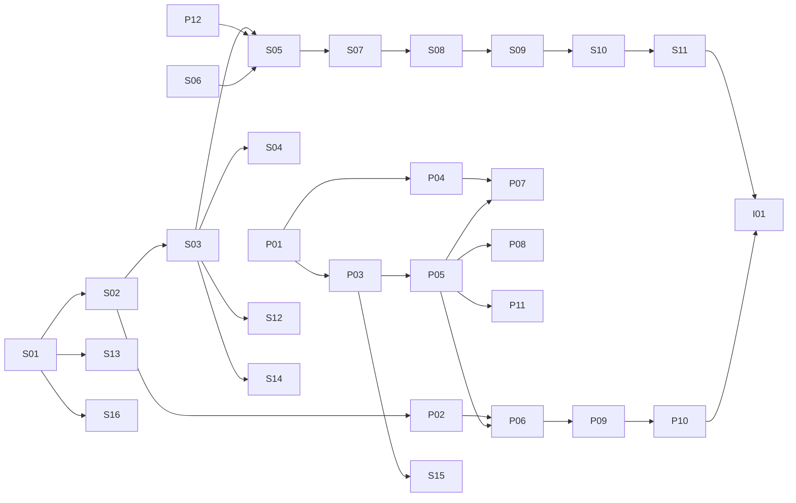

# Etappe 0 – Vorbereitung, Spikes und Zerlegung von Etappe 1

> **Status:** Entwurf zur Freigabe durch den CEO. Grundlage ist [`plan.md`](plan.md) Version 1.4.
> **Konvention:** Wie in `plan.md`. Aussagen mit Quelle sind verifiziert (Abfrage am 25.10.2026).
> Aussagen mit **[Annahme]** sind nicht verifiziert.
> **Inhalt:** (1) Checkliste für den CEO, (2) Entwurf der Anfrage an Anthropic (S4), (3) Plan für die
> Spikes S1–S3, (4) Zerlegung von Etappe 1, (5) vorgeschlagene Änderungen an `plan.md`.

---

## 1. Checkliste für den CEO

Reihenfolge so gewählt, dass nichts auf etwas Späteres wartet. Punkte mit ⚠ wirken nach außen oder
kosten Geld.

### 1.1 Zielmaschine: Entwicklungsmaschine des CEO (VPS zurückgestellt)

**CEO-Entscheidung (25.10.2026):** In der Entwicklungsphase läuft das AI-Office auf der
Entwicklungsmaschine des CEO. Der VPS (E8, O5) und das Backup des Anbieters (E21) sind
zurückgestellt. Der Anbietervergleich vom 25.10.2026 steht im ersten Commit dieses PR (`ddec55c`);
die Preise müssen vor einer späteren Bestellung ohnehin neu geprüft werden.

**Entwicklungsmaschine (Angaben des CEO):** Windows 11 Pro (10.0.26200), AMD Ryzen 5 5600X
(6 Kerne), 64 GB RAM, Laufwerke C: 62,5 GB, D: 137 GB, F: 1,35 TB, G: 711 GB.

**Empfehlung: eine Hyper-V-VM mit Ubuntu Server LTS als Zielumgebung.**
Das Rechtemodell aus Kap. 4.7 setzt Linux voraus: getrennte Unix-Nutzer, nftables-Regel für die UID
von `aio-office`, `SO_PEERCRED` am Unix-Socket, Docker ohne Zugriff für `aio-office`, systemd.
Hyper-V ist in Windows 11 Pro enthalten
([Microsoft Learn](https://learn.microsoft.com/en-us/windows-server/virtualization/hyper-v/get-started/install-hyper-v)).

Warum nicht WSL 2 oder Docker Desktop:
- WSL 2 bindet standardmäßig alle festen Windows-Laufwerke unter `/mnt` ein (`[automount]
  enabled`, Standard `true`) und erlaubt Linux-Prozessen, Windows-Programme zu starten (`[interop]
  enabled`, Standard `true`) ([Microsoft Learn: wsl.conf](https://learn.microsoft.com/en-us/windows/wsl/wsl-config)).
  Beides lässt sich abschalten, aber jeder Fehler in dieser Konfiguration gäbe dem Office Zugriff auf
  Ihre persönlichen Daten und auf Windows.
- WSL fährt die VM nach Leerlauf herunter (`vmIdleTimeout`, `instanceIdleTimeout`, ebenda). Das passt
  nicht zu einem Dienst, der dauerhaft läuft.
- Docker Desktop nutzt ebenfalls WSL 2 bzw. eine eigene VM. Die Trennung aus Kap. 4.7 wäre dort
  nicht so umsetzbar wie geplant **[Annahme]**.
- Eine Hyper-V-VM hat einen eigenen Kernel, keinen Zugriff auf Windows-Laufwerke und keine
  Interop. Sie verhält sich wie der spätere Server, die Skripte lassen sich unverändert übernehmen.

**Folgen für den Plan:**
- **Sicherheit:** Die Lauf-Container laufen in der VM, nicht direkt unter Windows. Eine Lücke in
  der Container-Isolation trifft zunächst die VM. Die VM bekommt keine geteilten Ordner und keine
  Windows-Zugangsdaten.
- **S3** misst die Statik innerhalb der VM. Die Servergröße für später leite ich daraus ab.
- **Backup (E21) und Abnahmekriterium 12:** Ersatz ist die tägliche SQLite-Sicherung (Paket S15)
  plus Hyper-V-Prüfpunkte vor riskanten Schritten (nur kurzzeitig, sie belegen Platz auf D:) und
  ein regelmäßiger VM-Export auf die HDD F: oder G:. Die Sicherung liegt damit auf einem anderen
  Datenträger als die VM. Der Rücksicherungstest läuft
  gegen diese Sicherung.
- **Abnahmekriterium 10** („Neustart des VPS“) gilt für den Neustart der VM und den Neustart von
  Windows. Die VM startet mit Windows automatisch (automatische Startaktion in Hyper-V).
- **VPN** ist nicht nötig. Der Zugriff erfolgt vom Windows-Browser auf die VM im internen
  Hyper-V-Netz.

**Schritte für Sie:**
1. Hyper-V aktivieren: PowerShell als Administrator,
   `Enable-WindowsOptionalFeature -Online -FeatureName Microsoft-Hyper-V -All`, danach Neustart
   (Microsoft Learn, siehe oben).
2. VM anlegen (Hyper-V-Manager → Neu → Virtueller Computer):
   - Generation 2, Name `aio-dev`
   - Arbeitsspeicher 16 GB, **dynamischer Arbeitsspeicher aus** (feste Grenzen für die Statik)
   - 8 virtuelle Prozessoren (der Ryzen hat 6 Kerne mit 12 Threads)
   - virtuelle Festplatte dynamisch erweiterbar, Obergrenze 100 GB, auf **D:** (SSD). Bedarf in
     Etappe 1 geschätzt 40–60 GB: Ubuntu, Docker-Images, Registry-Cache, Arbeitsbereiche,
     Prüfpunkte **[Annahme, S3 misst es]**. Auf einer HDD wären Paketinstallationen und
     Docker-Schichten deutlich langsamer, und S3 würde nicht zum späteren Server mit SSD passen.
     Eine zusätzliche SSD lohnt sich erst, wenn D: zu wenig Platz hat oder S3 Platzmangel zeigt.
   - Netzwerk: „Default Switch“
   - Ubuntu Server 24.04 LTS (oder die neueste LTS) als ISO von ubuntu.com
   - Sicherer Start: Vorlage „Microsoft UEFI-Zertifizierungsstelle“, sonst startet Ubuntu nicht
     **[Annahme: im Assistenten prüfen]**
   - Automatische Startaktion: „Immer automatisch starten“
3. Ubuntu installieren: OpenSSH-Server aktivieren, eigener Admin-Nutzer, nach der Installation
   `sudo apt update && sudo apt full-upgrade` und `unattended-upgrades`.
4. Docker Engine nach der offiziellen Anleitung für Ubuntu installieren (nicht Docker Desktop).
5. Einen Prüfpunkt „frisch installiert“ anlegen.
6. Mir die IP-Adresse der VM nennen. Das Provisionierungsskript (Paket S16) legt danach die Nutzer
   `aio-sup` und `aio-office` an.

**Interne Namen und TLS (neu, im Plan bisher nicht ausgeführt):**
- Die Cookies mit Präfix `__Host-` (Kap. 4.7) verlangen `Secure`, also HTTPS. Weil der Browser
  unter Windows auf die VM zugreift und nicht auf `localhost`, braucht es schon jetzt eine eigene
  kleine Zertifizierungsstelle. Ihr Stammzertifikat tragen Sie einmal in Windows als
  vertrauenswürdig ein; das Skript dafür kommt mit Paket S16. Die Namen lösen Sie über die
  `hosts`-Datei von Windows auf.
- Der Plan nennt `.aio.intern` als Beispiel. `.intern` ist **nicht** reserviert. Reserviert für
  private Nutzung ist `.internal` (ICANN-Beschluss vom 29.07.2024, zitiert in
  [draft-davies-internal-tld-06](https://www.ietf.org/archive/id/draft-davies-internal-tld-06.html)).
  Vorschlag: `office.aio.internal` und `konsole.aio-sup.internal` (verschiedene Domains, wie in
  Kap. 5.11 empfohlen).

### 1.2 GitHub App ⚠

Rechte nach Kap. 5.9. **Der private Schlüssel kommt nie in ein Repo, eine Nachricht oder diesen
Chat.**

1. Profilbild → **Your organizations** → bei `Steuten-IT-Solutions` **Settings** →
   **Developer settings** → **GitHub Apps** → **New GitHub App**
   ([GitHub-Doku](https://docs.github.com/en/apps/creating-github-apps/registering-a-github-app/registering-a-github-app)).
2. **GitHub App name:** z. B. `aio-supervisor` (höchstens 34 Zeichen, weltweit eindeutig).
3. **Homepage URL:** URL des Repos `AI-Office`.
4. **Webhook → Active:** abwählen (Plan: Polling, Kap. 5.9).
5. **Repository permissions:**
   - Contents: Read & write
   - Pull requests: Read & write
   - Issues: Read & write
   - Checks: Read-only
   - Metadata: Read-only (Pflicht)
   - **Workflows: No access** (E30)
   - alles andere: No access
6. **Where can this GitHub App be installed?** „Only on this account“.
7. **Create GitHub App**, dann auf der App-Seite einen privaten Schlüssel erzeugen. Die Datei bleibt
   bis zur Einrichtung des Supervisors offline bei Ihnen.
8. **Installieren** nur auf `AI-Office` („Only select repositories“), **nicht** auf
   `ai-office-supervisor` (E35). Für Spike S1 zusätzlich vorübergehend auf ein Test-Repo (siehe 3.1).

### 1.3 Repo `ai-office-supervisor` ⚠

Anlegen in der Organisation, nur Sie haben Schreibrechte, App nicht installiert (E35).
Sichtbarkeit: **privat** (CEO-Entscheidung vom 25.10.2026).

### 1.4 Repo-Einstellungen `AI-Office` ⚠

Nach Kap. 5.9. Pfad: Repo → **Settings**.

1. **Actions → General:** „Workflow permissions“ auf nur Lesen. „Fork pull request workflows from outside collaborators“ auf **Require approval
   for all external contributors**.
2. **Branches → Add classic branch protection rule** für `main`
   ([GitHub-Doku](https://docs.github.com/en/repositories/configuring-branches-and-merges-in-your-repository/managing-protected-branches/managing-a-branch-protection-rule)):
   - Require a pull request before merging
   - Require approvals: 1
   - Dismiss stale pull request approvals when new commits are pushed
   - Require review from Code Owners
   - Require approval of the most recent reviewable push
   - Require status checks to pass before merging (die Checks gibt es erst nach Paket P01)
   - Require branches to be up to date before merging
   - Do not allow bypassing the above settings
   - Allow force pushes: **aus**; Allow deletions: **aus**
   - „Restrict who can push to matching branches“: nur die App. **[Annahme: Ob die App dafür in
     dieser Liste stehen muss, damit ihr Merge per API gelingt, prüft S1.]**
3. `CODEOWNERS` kommt per PR (Paket P01).
4. Die Schritte 2 und 3 erst nach dem Merge von P01 aktivieren. Sonst kann P01 selbst nicht
   gemergt werden. Bis dahin merged nur der CEO.

### 1.5 Claude: `setup-token` und voller Login ⚠

Nach E27 gibt es zwei Zugänge. Beide stellen Sie selbst her, beide in der VM `aio-dev` als Nutzer `aio-sup`
(der Nutzer entsteht mit dem Provisionierungsskript aus Paket S16; für die Spikes reicht vorerst ein
eigenes Spike-Verzeichnis).

1. **`setup-token`** (für die Lauf-Container): `claude setup-token` öffnet die
   Browser-Anmeldung. Das Token erscheint im Terminal und wird **nirgends gespeichert**. Es läuft ein
   Jahr und „can only make model requests“
   ([Doku](https://code.claude.com/docs/en/authentication#generate-a-long-lived-token)).
   Ablage: Datei `/etc/aio/secrets/claude-setup-token`, Modus 0600, Besitzer `aio-sup`. Das
   Erstellungsdatum notieren (Warnung 30 Tage vor Ablauf, Kap. 2.3).
2. **Voller Login** (nur für `/usage` im Supervisor): mit eigenem Konfigurationsverzeichnis, z. B.
   `CLAUDE_CONFIG_DIR=/etc/aio/claude-full claude`, darin `/login`. Über SSH zeigt der Browser
   einen Code, den Sie im Terminal einfügen (Doku, Abschnitt „Log in to Claude Code“). Die
   Anmeldung landet in `.credentials.json` mit Modus 0600 im angegebenen Verzeichnis.
3. Das Token **nicht** in eine Shell-Profildatei schreiben. Laut Doku wird `CLAUDE_CODE_OAUTH_TOKEN`
   in jeder neuen Sitzung gelesen, solange es dort steht.

### 1.6 Anfrage an Anthropic abschicken ⚠

Text in Abschnitt 2. Weg: Laut Doku sind Fragen zu zulässigen Authentifizierungsmethoden an den
Vertrieb zu richten: „For questions about permitted authentication methods for your use case, please
contact sales“ ([Legal and compliance](https://code.claude.com/docs/en/legal-and-compliance)).
Ergänzend der Support-Messenger in claude.ai (Initialen unten links → „Get help“ → „Send us a
message“; nur schriftlich, [Support-Artikel](https://support.claude.com/en/articles/9015913)).
Empfehlung: über beide Wege, mit Datum notieren. Die Antwort bitte schriftlich aufheben.

### 1.7 Freigaben, die ich vor den Spikes brauche

- Test-Repo für S1, z. B. `aio-spike-s1`, leer und **öffentlich**, weil Branch-Schutz für private
  Repos im Free-Tarif fehlt (Plan Fakt 14) und S1e ihn braucht. Es wird nach dem Spike gelöscht.
  Dazu die vorübergehende Installation der App darauf.
- Kontingent-Budget für S2: bis zu 5 Prozentpunkte des Wochenlimits, in einem ruhigen Zeitfenster
  (vom CEO am 25.10.2026 freigegeben, siehe 3.2).

---

## 2. Entwurf: Anfrage an Anthropic (Spike S4, Risiko R1)

Auf Englisch, weil Vertrieb und Support englischsprachig arbeiten. Platzhalter in `<…>`.

> **Subject:** Permitted use question: personal autonomous agent setup with Claude Code (`claude -p`) on a Max 5x plan
>
> Hello,
>
> I am a Claude Max 5x subscriber (account: `<E-Mail-Adresse des Abos>`). Before I put a project into continuous operation, I would like to confirm in writing whether it is permitted under my subscription. Your Claude Code documentation says that questions about permitted authentication methods should go to sales, so I am writing to you.
>
> **What I am building**
> A personal orchestration tool ("AI-Office") on my own computer (later on a dedicated server of mine). It runs several role-based AI agents (e.g. CTO, COO) that work on software repositories in my own GitHub organization, including the tool's own code. Every code change goes through a pull request that I review and approve personally.
>
> **How Claude is used**
> - Each agent step is a separate invocation of the unmodified, version-pinned Claude Code CLI in non-interactive mode (`claude -p`), started by my own scheduler.
> - Authentication uses a token I created myself with `claude setup-token` for my own account. A separate interactive login of mine is used only to read my own usage status.
> - Nobody except me uses the system. There is no product, no third-party users, no resale and no sharing of credentials.
> - The system runs unattended, i.e. agent runs can start without me triggering each one. It is designed to use at most about 60 % of my plan's limits and pauses before that point, so I keep the rest for my own interactive use. It also pauses when a rate-limit warning is reported.
>
> **My questions**
> 1. Is this unattended, scheduled use of `claude -p` with a `setup-token` from my own Max subscription permitted under the Consumer Terms and the Claude Code usage policy, given that the Consumer Terms exclude access "through automated or non-human means" except "where we otherwise explicitly permit it"?
> 2. Does it count as "ordinary, individual usage" in the sense of your Claude Code documentation, as long as it stays within my plan's usage limits?
> 3. If not: which plan or setup do you recommend for this use (e.g. API key billing, Team plan)?
> 4. Is querying my own usage status in a script (via `/usage` or the Agent SDK's usage report) acceptable, and roughly how often?
>
> I am happy to provide more detail. Thank you for a written answer.
>
> Kind regards,
> `<Name>`

**Begründung für den Wortlaut:** Die Anfrage beschreibt die Nutzung vollständig und ohne
Beschönigung, auch den unbeaufsichtigten Betrieb. Eine Freigabe, die auf einer unvollständigen
Beschreibung beruht, wäre wertlos. Die Zitate stammen aus den
[Consumer Terms, Abschnitt 3](https://www.anthropic.com/legal/consumer-terms) und
[Legal and compliance](https://code.claude.com/docs/en/legal-and-compliance) (Plan, Fakten 1 und 3).

---

## 3. Plan für die Spikes S1–S3

**Allgemein:**
- Alle Spikes laufen in der VM `aio-dev` (siehe 1.1) in `/opt/aio-spikes` mit Skripten, die per PR in dieses Repo
  kommen (Verzeichnis `spikes/`). Sie geben **nie** ein Token aus, sondern nur „gefunden / nicht
  gefunden“ bzw. Prüfsummen.
- Ergebnisse als Bericht `spikes/ergebnisse/S<n>.md` per PR, ohne Rohdaten, die Geheimnisse enthalten
  könnten.
- Die CLI-Version wird für alle Spikes fest gepinnt und im Bericht genannt (R9).
- Kontingent: S1 und S3 brauchen nur wenige kurze Läufe mit `haiku`. S2 darf bis zu 5 Prozentpunkte
  des Wochenlimits verbrauchen (vom CEO freigegeben).

### 3.1 S1 – Isolation

| Teil | Frage | Durchführung | Go | No-Go / Folge |
|---|---|---|---|---|
| S1a | Kann Bash im Container das `setup-token` lesen? | Container wie in Kap. 4.7 (nicht privilegiert, `--cap-drop ALL`, `--read-only`, `tmpfs`), CLI gepinnt, Sandbox mit `enableWeakerNestedSandbox`, `sandbox.credentials` (envVars, `mode: deny`), `allowUnsandboxedCommands: false`. Ein `claude -p`-Lauf (`haiku`, `--max-turns 3`) führt **nur** `bash /probe/probe.sh` aus. Das Skript sucht das Token in `env`, `/proc/*/environ`, `/proc/*/cmdline`, Dateien unter `$HOME` und `CLAUDE_CONFIG_DIR` und schreibt nur Treffer ja/nein je Fundort in eine Datei. Vergleich über SHA-256-Präfixe, nie über den Klartext. Zusätzlich: Startet die Sandbox in Docker überhaupt (bubblewrap braucht User-Namespaces)? | Kein Fundort enthält das Token, Sandbox aktiv | Kap. 5.7: R5 ausdrücklich akzeptieren, Ersatzprüfungen aus 5.13. Optional S1a′: CLI und Bash unter getrennten Nutzern im Container |
| S1b | Welche Anthropic-Endpunkte braucht das CLI? Funktioniert ein TLS-terminierender Proxy mit Allowlist? | `mitmproxy` als Proxy, CA per `NODE_EXTRA_CA_CERTS`. Drei typische Läufe (nur Text, mit Werkzeugen, mit einem lokalen MCP-Server). Protokoll: Host, Methode, Pfad (ohne Header und Inhalte). Mit `CLAUDE_CODE_DISABLE_NONESSENTIAL_TRAFFIC=1`, das laut [Doku](https://code.claude.com/docs/en/env-vars) Telemetrie, Fehlerberichte, Auto-Updates und Feature-Flags abschaltet. Danach zweiter Durchgang mit Allowlist und Prüfung, dass nur unser Token im `Authorization`-Header akzeptiert wird. | Die Läufe funktionieren mit Allowlist; ein Aufruf mit fremdem Key wird blockiert | Kanal als Restrisiko unter R6 entscheiden (Kap. 5.7) |
| S1c | Lehnt GitHub einen Push auf `.github/workflows/` ab, wenn die App keine Berechtigung „Workflows“ hat? (Plan Fakt 17, Annahme) | Im Test-Repo mit Installations-Token der App: (1) `git push` eines Commits, der eine Workflow-Datei anlegt; (2) dasselbe über die Contents-API; (3) Änderung einer bestehenden Workflow-Datei. | Alle drei abgelehnt | Workflow-Änderungen zusätzlich im Git-Gate sperren (Pfadfilter), Plan anpassen |
| S1d | Reichen die Rate-Limits der App für Polling? | Doku: mindestens 5.000 Anfragen pro Stunde je Installation, höchstens 12.500 ([GitHub-Doku](https://docs.github.com/en/rest/using-the-rest-api/rate-limits-for-the-rest-api)). Gemessen wird der tatsächliche Bedarf eines Poll-Zyklus (PR-Liste, Reviews, Checks je offenem PR) über die Header `x-ratelimit-*`, auch für bedingte Anfragen mit `ETag` (ob 304-Antworten zählen, sagt die Doku nicht). | Bedarf bei 10 offenen PRs und 60-s-Intervall < 20 % des Limits | Intervall verlängern oder Webhook über einen Relay prüfen (Plan anpassen) |
| S1e | Gilt der Merge der App über die API trotz Branch-Schutz nur mit CEO-Approve? | Im Test-Repo: Schutzregel wie 1.4, Merge-Versuch der App ohne Approve, mit Approve auf altem SHA, mit Approve auf aktuellem SHA; mit und ohne App in „Restrict who can push“. | Merge nur im letzten Fall möglich | Einstellungen in 1.4 korrigieren |
| S1f | Lädt `claude -p` Einstellungen oder MCP-Server aus dem Arbeitsbereich? | Arbeitsbereich mit präparierter `.claude/settings.json` (Hook, der eine Markerdatei schreibt) und `.mcp.json`. Aufruf mit den Flags aus Kap. 5.7. Hintergrund: Laut [Doku](https://code.claude.com/docs/en/headless) führt `-p` ohne `--bare` Hooks aus `.claude/settings.json` aus und verbindet Server aus `.mcp.json`, auch in Ordnern ohne Vertrauensfreigabe. | Keine Markerdatei, kein fremder MCP-Server in `system/init` | Zusätzliche Flags (z. B. `--strict-mcp-config`) oder Dateien vor dem Lauf entfernen; Plan anpassen |
| S1g | Container-Netz | Aus dem Lauf-Container: Host, anderer Container, Internet direkt, DNS direkt → müssen scheitern; Proxy und Office-Port (Attrappe) → müssen gehen. | wie beschrieben | Netzaufbau korrigieren |

### 3.2 S2 – Kontingent

**Voraussetzung:** Der Zähler ist zwischen Ihrer Nutzung und dem Büro geteilt (Plan Fakt 5). Während
S2b und S2c dürfen Sie Claude **nicht** nutzen, sonst sind die Messungen wertlos.

| Teil | Frage | Durchführung | Go-Kriterium |
|---|---|---|---|
| S2a | Ist `/usage` per Skript abrufbar? | Mit vollem Login: (1) `claude -p "/usage" --output-format json`; (2) Agent SDK (TypeScript) mit `/usage`-Prompt, Auswertung des `SDKUsageReport`. Ob `/usage` im Print-Modus geht, sagt die [Headless-Doku](https://code.claude.com/docs/en/headless) nicht; sie nennt nur, dass Befehle nur für die Terminaloberfläche wie `/login` dort fehlen. Vergleich mit der Anzeige in claude.ai (Ihr Screenshot zum selben Zeitpunkt). | Maschinenlesbar: je Fenster `kind`, `percent`, `resets_at`; Werte stimmen mit claude.ai überein (± 1 Prozentpunkt) |
| S2b | Kostet die Abfrage Kontingent? | 30 Abfragen in Folge, Prozentwerte vorher und nachher, Kosten aus der JSON-Ausgabe. | Kein messbarer Anstieg, `total_cost_usd` = 0 oder vernachlässigbar |
| S2c | Wie stabil ist der Faktor „geschätzte USD → Prozentpunkte“? | Standardlauf (fester Prompt, feste Werkzeugnutzung) je Modell `haiku` und `sonnet`, in Blöcken zu je 5 Läufen, `/usage` vor und nach jedem Block (die Prozentwerte sind möglicherweise ganzzahlig, deshalb Blöcke). 6 Blöcke je Modell. Faktor = Δ Prozentpunkte / Σ `total_cost_usd`. | Verhältnis 90-%-Quantil / Median ≤ 1,5 (entspricht dem Anfangszuschlag aus Kap. 6) |
| S2d | Grundkosten pro Lauf | Minimaler Lauf mit Office-ähnlichem Aufbau (System-Prompt, Verfassung, MCP-Server mit den 8 Werkzeugen als Attrappe), Prompt „Antworte mit OK“. Ausgewertet: `usage` (Input, Cache-Erstellung, Cache-Lesen, Output) und `total_cost_usd`, je Modell, je 3 Läufe. | Kein Go/No-Go; der Wert geht in Bündelung und Weckbudget ein |
| S2e | Kommt `rate_limit_event` im `stream-json`? | Mitlesen aller Ereignistypen in den Läufen aus S2c. | Dokumentiert; Grundlage für die Pause bei `allowed_warning` |

**Folge bei No-Go (S2a oder S2c):** Fallback aus Kap. 6 (Wochenbudget in USD, Pause bei
`allowed_warning`), E3 gilt dann nur als Näherung. Das melde ich Ihnen ausdrücklich.

**Kontingent-Bedarf [Annahme, Schätzung]:** S2c ist der größte Posten: 60 Läufe, davon 30 mit
`sonnet`. Ich begrenze den Spike mit `--max-budget-usd` je Lauf und breche ab, sobald der
Wochenzähler um mehr als die freigegebene Menge gestiegen ist.

### 3.3 S3 – Statik

| Teil | Messung | Durchführung |
|---|---|---|
| S3a | Ruhebedarf eines Lauf-Containers mit CLI | Ein kurzer `haiku`-Lauf; RAM-Spitze aus der cgroup (`memory.peak`), CPU-Zeit, Startzeit |
| S3b | Werkbank-Last ohne LLM | Im Lauf-Image ohne CLI-Aufruf: Klon von `AI-Office` (nach P01), `pnpm install` über den Registry-Cache mit `--ignore-scripts`, Typecheck, Lint, Tests. RAM-Spitze, CPU, Dauer, Plattenbedarf des Arbeitsbereichs und des Caches |
| S3c | Parallelität | 1, 2, 4 und 6 gleichzeitige Werkbank-Läufe (S3b), Messung von Dauer, RAM, CPU-Steal und I/O-Wartezeit |
| S3d | Plattenhaushalt | Größe von Images, Registry-Cache, Docker-Logs bei den Limits aus Kap. 5.7, Office-DB-Wachstum (synthetisch) |

**Ergebnis statt Go/No-Go:** Statik = min(⌊(RAM − Reserve) / RAM-Spitze je Lauf⌋,
⌊(Platte frei − Reserve) / Platte je Lauf⌋, CPU-Grenze aus S3c). Reserve **[Annahme]**: 3 GB RAM
für Supervisor, Office, Proxy und Betriebssystem, 20 GB Platte. **No-Go** nur, wenn weniger als
2 gleichzeitige Werkbank-Läufe möglich sind; dann die Parallelität entsprechend begrenzen und den späteren Server größer
dimensionieren.

### 3.4 Reihenfolge und Abhängigkeiten

1. S1c, S1d, S1e (brauchen nur GitHub) → sofort nach Freigabe des Test-Repos.
2. S1a, S1b, S1f, S1g, S3a (brauchen die VM `aio-dev` und `setup-token`).
3. S2 (braucht vollen Login und das ruhige Zeitfenster).
4. S3b–S3d (brauchen P01, damit ein echtes Repo gebaut werden kann).

---

## 4. Zerlegung von Etappe 1 (MVP)

**Legende:** Repo **SUP** = `ai-office-supervisor`, **AIO** = `AI-Office`. Umfang: **S** ≈ bis
500 Zeilen, **M** ≈ 500–1.500, **L** ≈ über 1.500 Zeilen inkl. Tests **[Annahme, grob]**.
AK = Abnahmekriterium aus Kap. 7.4. Jedes Paket = ein Branch, ein PR.

### 4.1 Pakete

| ID | Repo | Paket | Inhalt | Abhängig von | Umfang | AK |
|---|---|---|---|---|---|---|
| **P01** | AIO | Monorepo-Gerüst | pnpm-Workspace, TypeScript strict, ESLint, Prettier, Vitest, CI-Workflow mit `permissions: {}` (Typecheck, Lint, Tests, Secret-Scan), `CODEOWNERS`, Node-Version gepinnt | – | S | Basis für 1, 2 |
| **S01** | SUP | Supervisor-Gerüst + Audit-Log | Wie P01; Konfiguration, Logging, Audit-DB (SQLite, nur Anhängen, Hash-Kette, E38) | Repo existiert | M | 11 (Nachweis) |
| **S02** | SUP | IPC-Protokoll v1 + Unix-Socket | Schemas der Aufrufe aus Kap. 4.6 (zod), Versionierung, Socket `/run/aio/supervisor.sock`, `SO_PEERCRED`, jeder Aufruf ins Audit | S01 | M | 8 |
| **P02** | AIO | Protokoll-Client | Kopie der Schemas aus S02 (fest auf eine Version), Client für das Office | S02 | S | – |
| **P03** | AIO | Ereignisprotokoll + Migrationen | SQLite WAL, Ereignistypen, Hash-Kette, unbekannte Typen speichern, Migrationsrahmen Expand/Contract, Migrationstest „Vorversion liest neuen Stand“ | P01 | M | 3, 11 |
| **P04** | AIO | `LlmRunner` + Fake-Runner | Schnittstelle, Parser für `stream-json` (Text, Werkzeugaufrufe, Kosten, `rate_limit_event`), Fake-Runner mit aufgezeichneten Läufen (E23) | P01 | M | 1, 8 |
| **P05** | AIO | Domänenmodell | Agentenprofile (4 Startagenten als versionierte Daten), Gebäude als Daten, Aufgaben, Nachrichten mit Art `auftrag`/`frage`/`info` | P03 | M | 11 |
| **P06** | AIO | Planer + Weckregeln | Bündelung, `info` weckt nicht, Weckbudget (Komfort), Zyklenerkennung im Nachrichtengraphen, Stillstand und PR-Obergrenze (E36), Lauf beantragen über P02 | P02, P05 | M | 7 |
| **P07** | AIO | Kontextaufbau + Auswertung | Persona-Verhaltensregeln, Verfassung, Handbuch mit Token-Obergrenze, Übergabenotiz, Postfach; Auswertung des Laufs in Ereignisse | P04, P05 | M | 1, 11 |
| **P08** | AIO | Office-API (MCP) | `send_message`, `create_task`, `delegate`, `handover`, `escalate`; Office-Token, Idempotenz (Lauf-ID + Sequenz) | P05 | M | 1, 7 |
| **P09** | AIO | Office-Gateway | HTTP + WebSocket, Login des CEO (Cookie `__Host-`, CSRF), CEO-Chat startet Lauf beim Empfänger | P05, P06 | M | 1 |
| **P10** | AIO | Webinterface schlicht | Zeitleiste, Chat, Kosten und Kontingent, Agentenliste, PR-Ansicht mit Hinweis „verbindlich ist GitHub“; nur `textContent`, ohne Inline-Skripte (CSP) | P09 | M | 9, 11 |
| **P11** | AIO | Startinhalte | Startbücher (Handbuch, Git-Workflow, Kostenregeln, Office-API), Persona-Texte der 4 Agenten | P05 | S | – |
| **P12** | AIO | Lauf-Image | Dockerfile, CLI gepinnt, Auto-Updater aus, Startprozess mit harter Lease (E42), Bundle-Erzeugung am Laufende | P01, S1 | S | 8, 10 |
| **S03** | SUP | Admission (ohne Kontingent) | Notaus-Zustand, Weckbudget, Statik und Speicher, Richtlinie für Lauftyp, Modell und Rechte, Schutzschalter (E11) | S02 | M | 5, 7 |
| **S04** | SUP | Kontingent | `/usage`-Abfrage oder Fallback (nach S2), Kalibrierung, Reservierung, Tages-Zielkurve, 55 % / 70 %, Selbstkorrektur, Meldung | S03, S2 | L | 6 |
| **S05** | SUP | Container-Manager | CLI-Aufruf bauen (Kap. 5.7), Managed Settings, Netz je Lauf, Limits, `tmpfs`, Log-Limits, zwei Tokens (E40), Rohprotokolle mit Obergrenze, Stop-Kaskade, Abgleich nach Neustart (E42) | S03, P12, S1 | L | 5, 8, 10 |
| **S06** | SUP | Egress-Proxy | Allowlist, TLS-Terminierung für Anthropic (falls S1b Go), Registry-Cache nur lesend, DNS nur über Proxy | S1 | L | 8 |
| **S07** | SUP | Supervisor-Gateway im Laufnetz | Prüfung des Supervisor-Tokens und der Absenderadresse; MCP-Werkzeuge `submit_bundle`, `open_pr`, `request_merge` (siehe 5.1) | S05 | M | 1, 8 |
| **S08** | SUP | Git-Gate | Bundle-Import in Bare-Repo ohne Hooks und Konfiguration, Ref-Prüfung, vergebene Branch-Namen, Commit-Identität, Secret-Scan, Ausgangsfilter (Länge, Muster, Fingerabdrücke), Push und PR über die App | S07, GitHub App | L | 1, 8 |
| **S09** | SUP | Merge-Gate | Polling, CEO-Approve auf Head-SHA, `main` ist Vorfahre, CI nur bei unveränderten Workflows, Merge, Tag; Workflow-PRs gesperrt; Wartungspfad `ceo/*` | S08 | M | 1, 2 |
| **S10** | SUP | Build + Deployer | Build-Container mit `--ignore-scripts`, Artefakt mit Prüfsumme zum SHA, Sicherung, Stop, Migration, Start, Beobachtung, Rollback, Revert-PR, Merge-Sperre, Unterscheidung Umgebungs- / Release-Fehler | S09 | L | 1, 3, 4 |
| **S11** | SUP | Health-Check + Negativtests | Checks aus Kap. 4.5 Nr. 8, Negativtests aus Kap. 5.13, Sandbox-Tests | S05, S08, S10 | M | 3, 4, 8 |
| **S12** | SUP | Konsole + CLI `aioffice` | Eigener Hostname, TOTP, Cookie `__Host-`, CSRF + `Origin`, `frame-ancestors 'none'`, Notaus in 3 Stufen, Freigaben, „Auslieferung anhalten“ | S03 | M | 5 |
| **S13** | SUP | Reverse-Proxy für das Webinterface | Setzt die Sicherheits-Header aus Kap. 4.7 und überschreibt die des Office | S01 | S | 9 |
| **S14** | SUP | Benachrichtigung | E-Mail bei Eskalation, Schutzschalter, Anmeldung, Stillstand, Überschreitung | S03 | S | 6, 7 |
| **S15** | SUP | Backup + Rücksicherung | Tägliche SQLite-Sicherung beider DBs vor dem Anbieter-Backup, Rücksicherungsskript, Test | S01, P03 | S | 12 |
| **S16** | SUP | Host-Provisionierung | Nutzer `aio-sup`/`aio-office`, Verzeichnisse und Rechte, nftables für `aio-office` (E41), systemd-Units mit Watchdog, Docker-Log-Limits, interne CA und Hostnamen | S01 | M | 10 |
| **I01** | beide | Abnahme in der VM `aio-dev` | Testprotokoll für AK 1–12, Ergebnis als Bericht | alle | M | 1–12 |

### 4.2 Reihenfolge

**Vorgeschlagene Wellen:**
1. **Welle A (sofort nach Freigabe, parallel zu den Spikes):** P01, S01, S16, P03, P04.
2. **Welle B:** S02, P02, P05, S03, S12, S13, P11.
3. **Welle C (braucht S1 und S2):** P12, S05, S06, S04, P06, P07, P08.
4. **Welle D:** S07, S08, S09, P09, P10, S14, S15.
5. **Welle E:** S10, S11, I01.

Größere Pakete (alle L sowie S02, S12) bekommen ein Copilot-Review. Die SUP-Pakete kann ich erst
bauen, wenn das Repo existiert und dieser Sitzung zugänglich ist.

### 4.3 Zuordnung der Abnahmekriterien

| AK | Pakete |
|---|---|
| 1 Kernkreislauf | P04, P07, P08, P09, S07, S08, S09, S10 |
| 2 Workflow-PR | S09 (+ Branch-Schutz, S1c) |
| 3 Rollback | S10, S11, P03 |
| 4 Speicher voll | S10, S11, S03 |
| 5 Notaus | S03, S05, S12 |
| 6 Kontingent | S04, S14 |
| 7 Zyklus, Weckbudget | P06, S03, S14 |
| 8 Negativ- und Sandbox-Tests | S11, S05, S06, S08 |
| 9 XSS | P10, S13 |
| 10 Neustart | S16, S05 |
| 11 Zeitleiste | P03, P05, P07, P10 |
| 12 Rücksicherung | S15 |

---

## 5. Vorgeschlagene Änderungen an `plan.md`

Diese Punkte sind bei der Zerlegung aufgefallen. Ich schlage sie nach Ihrer Rückmeldung in einem
eigenen PR vor.

1. **Zuordnung der Werkzeuge `submit_bundle`, `open_pr`, `request_merge`:** Kap. 7.3 führt sie in der
   Office-API, E40 verlangt aber, dass Container diese Aufrufe direkt an das Supervisor-Gateway
   übergeben. Vorschlag: Der Container bekommt **zwei** MCP-Server, die Office-API und das
   Supervisor-Gateway. Die drei Werkzeuge gehören zum Gateway (Paket S07). `open_pr` und
   `submit_bundle` lassen sich zusammenlegen, weil der Supervisor den PR nach dem Push ohnehin
   selbst öffnet (Kap. 4.5).
2. **Managed Settings des Lauf-Containers:** Kap. 5.7 legt sie ins Image, das Image ändern Agenten
   per PR. Vorschlag: Der Supervisor bindet die Datei schreibgeschützt aus seinem eigenen Repo ein.
   Dann kann ein Image-PR die Rechte der Läufe nicht verändern.
3. **Interne Hostnamen:** `.internal` statt `.intern` (siehe 1.1), TLS über eine eigene CA ergänzen.
4. **VPN (für den späteren Server):** Tailscale als Beispiel streichen oder auf die Lizenzgrenze
   hinweisen: Der kostenlose Tarif ist laut Anbieter „only suitable for non-commercial use“
   ([tailscale.com/pricing](https://tailscale.com/pricing)). Empfehlung: WireGuard.
5. **Repo-Inhalte im Arbeitsbereich:** Prüfung S1f ergänzen (Hooks und `.mcp.json` aus dem Repo).
6. **E8, E21, O5:** In der Entwicklungsphase läuft das System in einer Hyper-V-VM auf der
   Entwicklungsmaschine des CEO, VPS und Anbieter-Backup sind zurückgestellt (siehe 1.1). Abnahmekriterien 10 und 12
   entsprechend anpassen.
